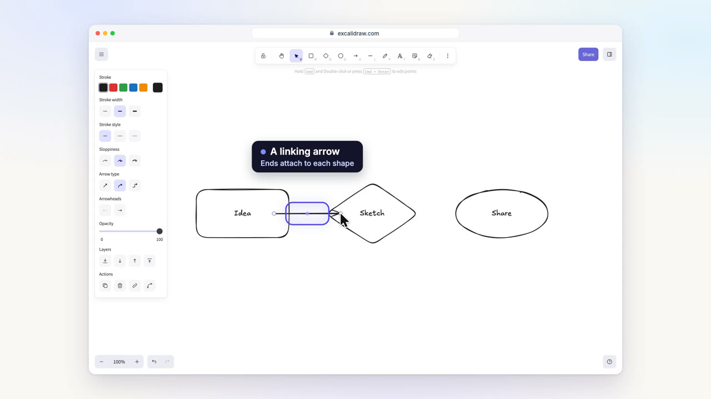
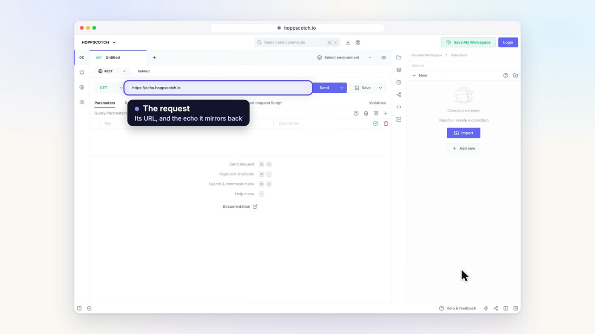
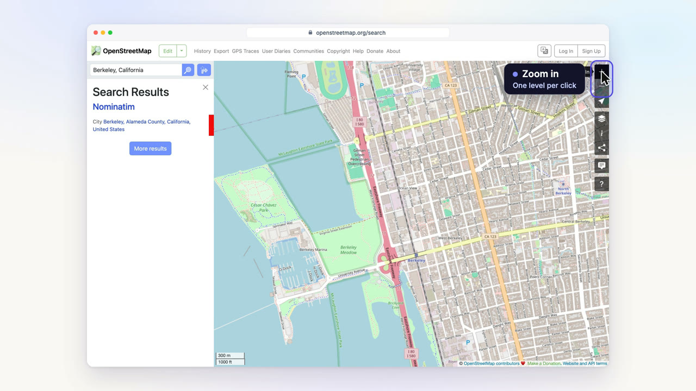
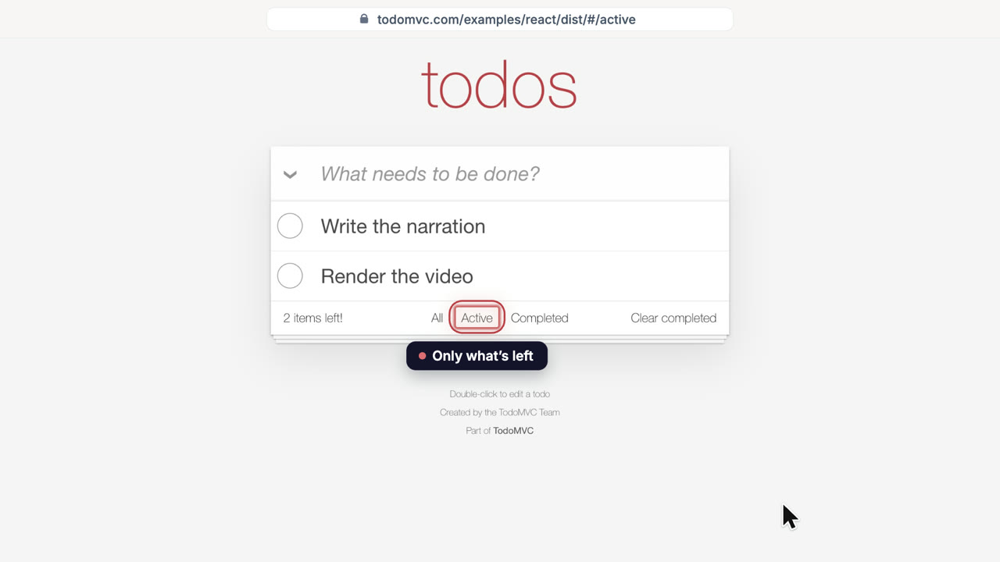
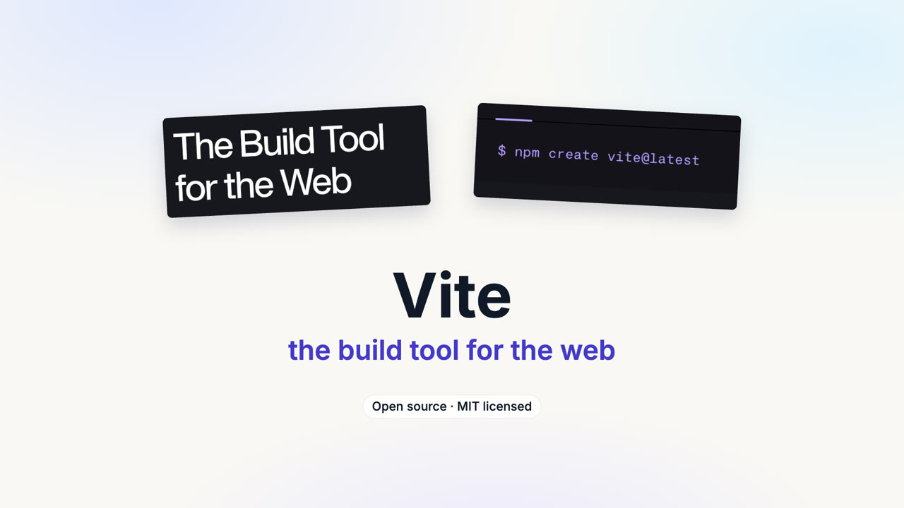

# demo-reel — narrated product demo videos from a real, running app

An engine for short product demo videos made from real footage of a running web app. Headless Chrome captures the app as 2× plates, or records its own motion frame by frame on a virtual clock, along with the boxes of the elements on screen. A deterministic Canvas2D renderer puts that footage in a browser window over a soft backdrop and adds a camera, a cursor, labels pinned to the real elements, narration and UI sounds. Every frame is a function of time, so the browser preview and the 1080p60 (or 4K) export are identical.

No music, ever: the soundtrack is a locally voiced narrator (Kokoro, open weights) plus quiet synthesised UI sounds placed by the scenes themselves.

- **How to make a video**, start to finish, with the checks it must pass: [`docs/WORKFLOW.md`](docs/WORKFLOW.md)
- **The house style** (look, motion, voice, sound, honesty rules): [`docs/STYLE.md`](docs/STYLE.md)
- **The engine's APIs** (capture, recorder, scenes, themes, rendering): [`docs/ENGINE.md`](docs/ENGINE.md)
- **Each project's treatment**: [`projects/`](projects/) (`projects/<name>/treatment.md`)

## Gallery

Five edits, all filmed from real, running open-source apps. Each links to its treatment (the story, the honesty notes and what the capture needs).

| | |
|---|---|
| [](projects/excalidraw/treatment.md)<br>**[Excalidraw](projects/excalidraw/treatment.md)** · 0:48<br>Real drags and typing on a canvas. | [](projects/hoppscotch/treatment.md)<br>**[Hoppscotch](projects/hoppscotch/treatment.md)** · 0:38<br>Two live requests, and the response echoing them. |
| [](projects/openstreetmap/treatment.md)<br>**[OpenStreetMap](projects/openstreetmap/treatment.md)** · 0:34<br>A search, a fly-to, and live map tiles. | [](projects/todomvc/treatment.md)<br>**[TodoMVC](projects/todomvc/treatment.md)** · 0:27<br>A recorded session, wearing the app's own red. |
| [](projects/vite/treatment.md)<br>**[Vite](projects/vite/treatment.md)** · 0:19<br>Shots only: one full-page plate, moved over. | |

The stills above are frames of the rendered videos. The MP4s themselves are not committed (renders are gitignored); `bun projects/<name>/capture.ts` and the render commands below make them in a few minutes each.

## Layout

The repo is organised **by project**: everything specific to one video is in one directory, and everything shared is outside `projects/`.

```
projects/<name>/        one video, and only that video's files
  capture.ts            drives the real app and writes footage/
  timeline.ts           the edit: which scenes play when, and its theme
  scenes/               its beats, one module each
  footage/              captured plates (gitignored) and manifest.json (committed)
  treatment.md          the story, honesty notes and capture needs
app/src/engine/         shared: timeline, window/camera/cursor, drawing, theme
app/src/scenes/         shared: the reusable title, chapter and end cards
app/src/player/         shared: the HTML player (app/player.html), which plays an edit in a browser
capture/                shared: the capture toolkit (browser launch, virtual clock, recorder, peek)
scripts/                shared: render.ts (stills, sheets, motion check, MP4), audio.ts (narration + sound),
                        build.ts (the HTML player for one edit)
e2e/                    browser tests of the built player (bun run test:e2e)
docs/                   the workflow, house style and engine guides
out/                    renders, stills and contact sheets (gitignored)
```

Adding a video means adding one directory under `projects/`; there is nothing to register.

## Requirements

[bun](https://bun.sh), Google Chrome (driven through `playwright-core`'s `chrome` channel) and ffmpeg. The fonts (Inter, Instrument Serif; SIL OFL) come from npm. Kokoro's model downloads from Hugging Face on the first `audio.ts` run.

## Quick start

```sh
bun install
bun projects/todomvc/capture.ts                 # films todomvc.com's React app (~40 s)
bunx vite                                        # preview: http://localhost:5180/?edit=todomvc
bun scripts/audio.ts --edit todomvc              # narration + sound effects → out/audio-todomvc/mix.wav
bun scripts/render.ts video --edit todomvc --audio out/audio-todomvc/mix.wav --out out/todomvc.mp4
bun scripts/build.ts --edit todomvc              # the HTML player: a static folder, out/web-todomvc/
```

## Tests

```sh
bun run test        # unit tests (bun test): the player's clock, project helpers
bun run test:e2e    # the built player in headless Chrome; needs the edit's footage and audio (E2E_EDIT=<name>, default news-digest)
```

## Troubleshooting

- **macOS: `library load disallowed by system policy` (onnxruntime or sharp) when running `audio.ts`.** Files that came from another machine or an archive carry a quarantine attribute, and macOS then refuses to load their native libraries into bun. Clear it on the installed packages: `xattr -dr com.apple.quarantine node_modules`.
- **`bun: command not found`.** Install bun first (`brew install oven-sh/bun/bun`, or see [bun.sh](https://bun.sh)).

## The edits

| Edit | What it shows | Footage | Length |
|---|---|---|---|
| `todomvc` | [TodoMVC](https://todomvc.com)'s React app: three todos added, one completed, the Active filter. One recorded session; wears TodoMVC's own red through an edit theme. | `bun projects/todomvc/capture.ts` (a recorded clip) | 0:27 |
| `vite` | [Vite](https://vite.dev)'s homepage: a push into the install command, then a scroll to the features. Shots only, in the default theme. | `bun projects/vite/capture.ts` (one full-page plate) | 0:19 |
| `excalidraw` | [Excalidraw](https://excalidraw.com): pick a shape, drag it out, label it, then join a rectangle, a diamond and an ellipse with arrows. | `bun projects/excalidraw/capture.ts` (a recorded clip, real drags and typing) | 0:48 |
| `hoppscotch` | [Hoppscotch](https://hoppscotch.io): add a query parameter to a request, send it, and read the echo of it in the real response; then a second parameter. | `bun projects/hoppscotch/capture.ts` (a recorded clip, two live requests) | 0:38 |
| `openstreetmap` | [OpenStreetMap](https://www.openstreetmap.org): search a city, watch the map fly to it, zoom down to the streets. | `bun projects/openstreetmap/capture.ts` (a recorded clip, live map tiles) | 0:34 |
| `qiyami` | [Qiyami](https://www.qiyami.com): a prayer-time and last-third-of-the-night calculator; the dashboard, then the settings sheet (Asr method, city override). | `bun projects/qiyami/capture.ts` (a recorded clip, live site) | 0:47 |
| `news-digest` | [News Digest](https://github.com/EmmadUsmani/news-digest): a slide-led reel for engineers about the agent factory that builds the app (one Codex agent in a supervisor loop, steered through repo files), with animated diagrams and real-data charts, then the product's architecture. | `bun projects/news-digest/capture.ts` (the build agent's own screenshots + live GitHub), `stats.ts`, `measure.ts`; audio at `--speed 1.1` | 8:36 |

`todomvc` and `vite` are the short worked examples of the two ways to film: a frame-by-frame recording of the app's own motion, and still plates the renderer moves over. The other three are fuller recorded sessions (drawing on a canvas, a live network request, a live map). All five film public open-source sites, so they re-record anywhere with a network connection. Point `BASE_URL` at a local or self-hosted build to film that instead.

Every project has a treatment (`projects/<name>/treatment.md`): its story, what is specific to it, and what the capture needs.

To make your own, follow [`docs/WORKFLOW.md`](docs/WORKFLOW.md): write a treatment, a capture script, a scene or two and a timeline entry.
